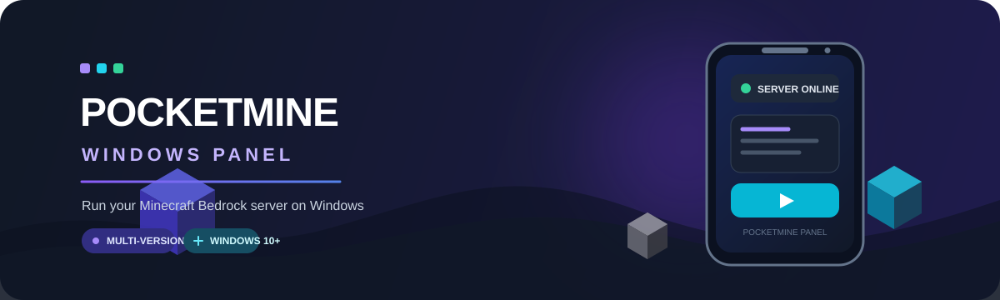

<p align="center">
  
</p>

<p align="center">
  
</p>

<p align="center">
  <strong>The Windows port of Android-PacketMinePm-Panel.</strong>
  <br>
  Run a Minecraft Bedrock server locally on your Windows PC with PocketMine-MP - a native desktop app, no phone required.
</p>

<p align="center">
  <a href="https://github.com/EXBYPIXEL/Windows-PacketMinePm-Panel/stargazers"></a>
  <a href="https://github.com/EXBYPIXEL/Windows-PacketMinePm-Panel/network/members"></a>
  <a href="https://github.com/EXBYPIXEL/Windows-PacketMinePm-Panel/issues"></a>
  
</p>

---

## ✨ About

**Windows PacketMinePm Panel** is a 1:1 desktop port of [Android-PacketMinePm-Panel](https://github.com/EXBYPIXEL/Android-PacketMinePm-Panel). It lets you run **PocketMine-MP** locally on a Windows PC and host a **Minecraft Bedrock** server without a separate server machine.

The whole panel UI, every feature and every tool of the Android app is preserved - only the Android plumbing (WebView client, SAF file pickers, foreground service, battery optimizations) was replaced with native Windows equivalents.

## 📥 Releases — Start here

Visit the [Releases page](https://github.com/EXBYPIXEL/Windows-PacketMinePm-Panel/releases) and download:

- **`PMPanel-Setup-x.y.z-x64.exe`** - the installer (per-user install, no admin rights required)
- **`PMPanel-x.y.z-portable-win64.zip`** - the portable version; unzip anywhere and run `PMPanel.exe`

Everything is bundled: the Windows PHP runtime (official pmmp build), PocketMine-MP and the fake-player engine. No Java, no PHP, no dependencies to install.

## 🚀 Features (identical to the Android app)

- 🖥️ Run a PocketMine-MP server and host a Minecraft Bedrock world directly on your Windows PC
- 📱 **Same panel UI** - the original mobile interface (Persian/English, dark theme) runs unchanged inside the app
- 🧩 Choose from supported server versions (official pmmp + NG builds, with the built-in updater)
- 🧪 Test plugins with the built-in fake-player engine (`pmbot.exe`, built from the same Go source as the Android version)
- 🛠️ Compile or decompile your own plugins (pure-Java Phar tools, no PHP needed)
- 🗂️ Multi-server profiles with per-server ports, memory limits and consoles
- 📦 Config zip importer, backups & restore, file manager, property editor, log viewer
- 🛒 Poggit plugin market with icons, READMEs and one-click install
- 🌐 Public IP / UPnP port mapping, connectivity self-test, RCON console, GS4 query stats
- 📊 Live statistics: TPS, CPU & RAM of the server process, online players, network I/O
- 🔔 System tray icon keeps the server running in the background when you close the window - with a "stop all servers" shortcut

## 🛠️ Getting Started

1. Open **[Releases](https://github.com/EXBYPIXEL/Windows-PacketMinePm-Panel/releases)** and install the Setup exe (or unzip the portable version).
2. Launch **PM Panel** from the Start menu (or `PMPanel.exe`).
3. Select the version you want in the panel, press **Start**, and share your address (see the network tools in the Tools tab).

> Data (servers, worlds, plugins, settings) lives in `%APPDATA%\PMPanel` - same layout as the Android app's private storage.

## 🏗️ How the port works

| Android | Windows |
| --- | --- |
| `WebView` (Chromium) + `addJavascriptInterface` | JavaFX `WebView` + local loopback UI server with the same `window.PMPanel` JSON bridge |
| Bundled ARM PHP (`libpmphp.so`) | Official pmmp **PHP 8.4 Windows x64** runtime, extracted on first run |
| Foreground service + notification | System tray icon (`TrayService`) |
| SAF file pickers | Native Windows file dialogs |
| `/proc/<pid>/stat` CPU & RSS sampling | PowerShell process probe (`WinProc`) |
| Battery optimization / wakelocks | Not needed on desktop (kept as harmless no-ops so the UI stays identical) |
| `pmbot` Go engine (`libpmbot.so`) | Same Go source, cross-compiled to `pmbot.exe` in CI |

The panel UI (`www/`) is bundled **byte-identical** to the Android app. A tiny runtime shim (injected by the desktop shell, not by the files) defers boot until the native bridge is attached and adds a TTF fallback for the Vazirmatn fonts.

### Build from source

Requirements: JDK 21, Go 1.25+ (for the bot engine).

```bash
# build the bot engine (or let CI download/build it)
cd pmbot && go build -trimpath -ldflags "-s -w" -o ../build/resources-native/native/pmbot.exe .
cd ..

# fetch the PHP runtime
curl -L -o build/resources-native/native/php-windows.zip ^
  https://github.com/pmmp/PHP-Binaries/releases/download/pm5-php-8.4-latest/PHP-8.4-Windows-x64-PM5.zip

# build the self-contained app image
gradlew packageApp
```

CI (`.github/workflows/build.yml`) builds everything on a Windows runner and attaches the installer + portable zip to every `v*` release.

## 🤝 Contributions and Issues

Have a suggestion or found a problem? Open an [issue](https://github.com/EXBYPIXEL/Windows-PacketMinePm-Panel/issues). When reporting a bug, include your Windows version, app version, and steps to reproduce it.

## ⭐ Support the Project

If you find this project useful, consider giving it a **Star** to help others discover it.

<p align="center">
  Made for the Minecraft Bedrock and PocketMine-MP community 💜
</p>
